  

# 🧾 Awesome Credit Notes & Accounts Receivable Credit

  
  
  
  
  
  

---

## 🌟 Overview & Purpose

A curated, comprehensive guide to the **Credit Notes, Accounts Receivable (AR) Automation, and B2B Credit Risk Management Ecosystem**. 

Managing B2B credit-to-cash workflows requires precision: from issuing compliant **credit notes** (credit memos, price adjustments, rebates, and proration refunds under ASC 606 / IFRS 15) to automating collections, predicting payment delays, matching cash remittances, and assessing customer counterparty credit risk with real-time bureau intelligence.

This list tracks the leading commercial SaaS platforms and premier open-source / self-hosted alternatives—built for CFOs, controllers, AR analysts, revenue operations managers, and fintech engineers.

---

## 📑 Table of Contents
- [📊 Sector Overview & Market Dynamics](#-sector-overview--market-dynamics)
- [☁️ SaaS & Hosted Platforms](#️-saas--hosted-platforms)
- [💻 Open-Source GitHub Projects](#-open-source-github-projects)
- [🤝 How to Contribute](#-how-to-contribute)
- [💖 Support](#-support)
- [📈 Star History](#-star-history)
- [⚠️ Disclaimer](#️-disclaimer)

---

## 📊 Sector Overview & Market Dynamics

The global **Accounts Receivable (AR) Automation & B2B Credit Management** market is valued at approximately **$3.4B – $4.8B in 2025–2026** and is projected to surpass **$8.5B – $9.6B by 2030**, expanding at a Compound Annual Growth Rate (CAGR) of **13% to 15.8%**.

The sector exhibits **moderate fragmentation with dual-tier concentration**: the enterprise credit bureau and core risk scoring segment functions as an entrenched oligopoly dominated by credit reporting giants (Experian, Dun & Bradstreet, and Moody's/Cortera), while the invoice-to-cash workflow, automated dunning, and credit memo management layer is moderately fragmented among AI-native specialized platforms (HighRadius, Versapay, YayPay, Chargebee) competing with ERP modules and self-hosted open-source billing engines.

---

## ☁️ SaaS & Hosted Platforms

> [!NOTE]
> All SaaS platforms below are ranked and sorted in **descending order by company scale** (annual revenue / enterprise market valuation). Pricing reflects documented starting tiers or entry contracts; free tier and trial limits specify exact evaluation terms.

| Product | Company Scale (Revenue / Valuation) | Description | Starting Pricing | Free Tier / Free Trial Limits |
|:---|:---|:---|:---|:---|
| **[Experian Business](https://www.experian.com/)** | **~$8.9B Revenue** / ~$35B Market Cap (LSE: EXPN) | 🏢 Commercial credit bureau providing business credit scores, financial risk indicators, trade payment history, and continuous portfolio monitoring alerts for B2B counterparty risk. | **$12.95** per BizVerify report; **$49.95** single full report; or **$199/year** for Business Credit Advantage self-monitoring | **No free tier**; no public self-serve free trial; sample business report preview available via sales |
| **[Dun & Bradstreet](https://www.dnb.com/)** | **~$2.4B Revenue** / ~$4.1B Market Cap (NYSE: DNB) | 🏛️ Global trade credit authority issuing D-U-N-S numbers, PAYDEX scores, and comprehensive commercial credit reports used for vendor underwriting, trade credit limits, and credit-to-cash decisions. | **$149/month** (CreditBuilder Plus) or **$189.99** for single on-demand Business Information Report (BIR) | **No free tier**; free company D-U-N-S profile lookup only (no free trade credit trial without enterprise sales demo) |
| **[YayPay (Quadient AR)](https://www.quadient.com/)** | **~$1.2B Revenue** (€1.06B) / ~$560M Market Cap (Euronext: QDT) | 🤖 Intelligent AR automation platform by Quadient. Features predictive customer payment scoring, automated multi-channel dunning workflows, customer self-service billing portals, and ERP bi-directional sync. | **$500/month** (billed annually, ~$6,000–$8,000/year base depending on invoice volume and ERP connectors) | **No free tier**; free guided interactive demo provided upon sales qualification (no self-serve free trial) |
| **[Chargebee](https://www.chargebee.com/)** | **~$200M+ Revenue** / $3.5B Valuation | 💳 Subscription billing platform with comprehensive native **credit note support**: line-item adjustment credits, refundable credit memos, proration refunds, and promotional credits aligned with revenue recognition. | **$0/month + 0.80%** overage (Flow PAYG tier) or **$99/month + 0.65%** base tier | **No permanent free tier**; unlimited-duration developer sandbox (free test environment with mock payment gateways) |
| **[HighRadius Credit Cloud](https://www.highradius.com/)** | **~$350M+ Revenue** / $3.1B Valuation | ⚡ Autonomous Order-to-Cash and AI credit cloud. Integrates 40+ credit bureaus, automates credit limit application scoring, tracks real-time risk deterioration, and automates receivables cash matching. | **Outcome-Based Gain-Share** or ~$8,333/month (~$100,000/year baseline mid-market annual contract) | **No free tier**; custom pilot evaluation and tailored sandbox proof-of-concept upon sales scoping |
| **[Creditsafe](https://www.creditsafe.com/)** | **~$315M Revenue** (€289M) / High-Growth Private | 🌐 Comprehensive global business credit database covering 430M+ companies worldwide with credit scores, international payment intelligence, and risk verification designed for SMEs and mid-market teams. | **$149/month** (annual domestic contract) or **$37.50/month** ($360/year) partner app connector tier | **No free tier**; **30-day free trial** available for partner platform connectors and registered business web trials |
| **[Cortera (Moody's Pulse)](https://www.cortera.com/)** | **Subsidiary of Moody's** (~$6.8B MCO Revenue) / Moody's Analytics Group | 📈 B2B trade credit data cooperative and analytics engine tracking granular accounts receivable payment behaviors and monthly trade trends across commercial buyers. | **$99/month** starting tier (Cortera Pulse portfolio tracking; scales based on AR portfolio ledger size) | **No free tier**; no self-serve free trial; free interactive platform demo and sample ledger analysis upon request |
| **[Versapay](https://www.versapay.com/)** | **~$70M Revenue** / Private Equity Backed (Great Hill) | 🤝 Collaborative AR network and invoice-to-cash automation suite. Connects buyers and suppliers in a shared digital portal to dispute invoices, apply credit notes, and automate payment collections. | **$667/month** ($8,000/year minimum mid-market contract + transaction processing fees) | **No free tier**; free live platform demonstration and cash flow acceleration assessment via sales |

---

## 💻 Open-Source GitHub Projects

Open-source tools offer complete data sovereignty, zero per-invoice transaction fees, and full auditability for invoice lifecycle management, credit note issuance, and accounts receivable tracking.

> [!TIP]
> The table below is sorted in **descending order by GitHub star count**. Each star badge links directly to that repository's stargazers page.

| Project | Stars | Tech Stack | License | Description |
|:---|:---:|:---:|:---:|:---|
| **[Invoice Ninja](https://github.com/invoiceninja/invoiceninja)** |  | PHP / Laravel / Flutter | Source-Available | Full-featured billing, invoicing, and payment processing suite with native support for **credit notes**, customer balance adjustments, client portals, partial payments, and multi-currency billing. |
| **[Crater](https://github.com/crater-invoice-inc/crater)** |  | PHP / Laravel / Vue.js | Open-Source | Clean, self-hosted invoicing solution for freelancers and small businesses. Generates detailed invoices, estimates, credit trackings, and payment records with dedicated mobile and web apps. |
| **[Kill Bill](https://github.com/killbill/killbill)** |  | Java / OSGi | Apache-2.0 | Enterprise-grade, open-source subscription billing and payments engine. Features advanced accounts receivable accounting, invoice adjustments, **credit items**, payment retries, and plugin architecture. |
| **[Free GST Billing Software](https://github.com/IamRamgarhia/Free-GST-Billing-Software)** |  | JavaScript / HTML / Electron | MIT | 100% offline and open-source GST invoice and **credit note generator**. Supports bills of supply, quotations, GSTR-1/3B summary reports, and PDF credit note creation with zero signup requirements. |
| **[OCA Account Invoicing](https://github.com/OCA/account-invoicing)** |  | Python / Odoo | AGPL-3.0 | Odoo Community Association (OCA) modular extensions for enterprise financial workflows: compliant **credit memo generation**, invoice refund workflows, debit notes, and automated AR balance reconciliation. |
| **[webERP](https://github.com/timschofield/webERP)** |  | PHP / MySQL | GPL-2.0 | Battle-tested, mature open-source ERP system featuring a full **Accounts Receivable module** with customer credit checks, ledger drill-downs, overdue invoice tracking, and credit note allocations. |
| **[BillKu](https://github.com/ribato22/BillKu)** |  | TypeScript / NestJS / Next.js | MIT | Modern self-hosted, offline-ready (PWA) business management platform. Natively supports the full invoice lifecycle, **credit notes**, delivery orders, receivables aging breakdown, and WhatsApp invoice alerts. |
| **[BrassLedger](https://github.com/rhamenator/BrassLedger)** |  | C# / .NET / Avalonia | GPL-3.0 | Cross-platform desktop accounting application for Windows, macOS, and Linux. Provides receivables tracking, customer accounts, customer statements, balance ledgers, and cash application. |
| **[Orvaket](https://github.com/Akam1123/orvaket)** |  | JavaScript / Local-First | MIT | Local-first accounts receivable follow-up workspace for service firms. Ingests CSV exports from accounting software (QuickBooks/Xero), tracks unpaid receivables, and generates dunning drafts with AES-256-GCM encryption. |

---

## 🤝 How to Contribute

We welcome community contributions, corrections, and additions!

1. 🍴 **Fork** this repository.
2. 🌿 **Create a new branch** (`git checkout -b feature/add-new-ar-tool`).
3. 📝 **Add or update entries** in `README.md` keeping formatting clean, factual, and backed by verifiable starting pricing or GitHub metrics.
4. 🚀 **Commit your changes** (`git commit -m "Add ToolName to open-source AR table"`).
5. 📤 **Push to your branch** (`git push origin feature/add-new-ar-tool`).
6. 🎯 **Open a Pull Request** with a brief summary of the software and why it belongs in this collection.

---

## 💖 Support

If you find this curated list valuable for your financial stack, architecture research, or daily operations, please consider supporting the project:

- ⭐ **Star this repository** to help others discover it.
- 🍴 **Fork and share** with colleagues across finance and engineering teams.
- ☕ **Buy me a coffee / Sponsor**: If you appreciate this work, consider supporting through the [GitHub Sponsor Dashboard](https://github.com/sponsors/ishandutta2007). Your support helps maintain, expand, and verify the dataset!

---

## 📈 Star History

---

## ⚠️ Disclaimer

- This list is a **community-curated educational index** and does not constitute formal accounting, tax, or legal advice.
- Issuing credit notes, customer balance write-offs, and trade credit allowances involves strict statutory regulations under ASC 606, IFRS 15, and regional sales tax / VAT authorities.
- Business credit bureau reports (Experian, D&B, Creditsafe, Cortera) are governed by applicable trade credit reporting and commercial data regulations.
- Pricing metrics, product capabilities, and GitHub repository metrics are accurate as of early 2026 and are subject to change by respective owners.
